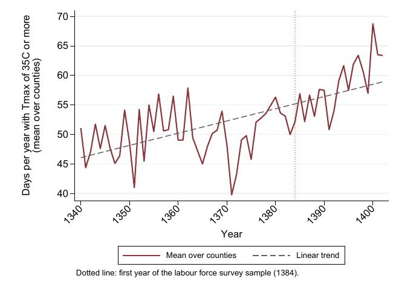
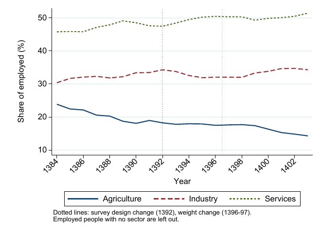
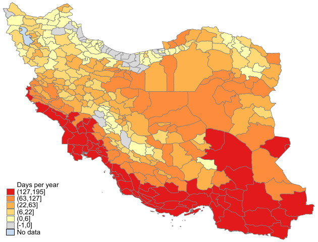
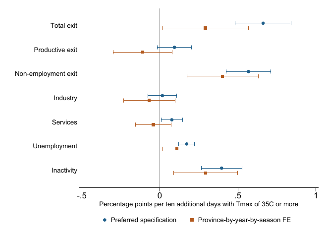

# Extreme Heat and Labor-Market Reallocation: Evidence from Iran

This is the code for my master's thesis at Sharif University of Technology (supervised by Dr. Amanzadeh, defended September 2026), which I am now turning into a paper.

The question is what a hot season does to people who work in agriculture. Do they move into industry and services, or do they drop out of work altogether? Iran is a good place to look at this: summers are getting hotter, agriculture still employs many people in rural areas, and the Labor Force Survey follows the same people for a year.

## The setting

Very hot days have become more common. The average county had about 48-51 days a year at or above 35°C between 1340 and 1370, and 63-69 days in 1400-1402. At the same time agriculture's share of employment fell from about 24 percent in 1384 to about 14 percent in 1403.

<p align="center">
  
  
</p>

Heat is very unevenly spread. Most of the hottest counties are in the south and south-east, while the Caspian coast and the north-west see few such days. County fixed effects take this cross-sectional difference out, so the estimates come from hotter and cooler seasons *within* the same county.

<p align="center">
  
</p>

## Data and design

- **Workers.** The rotating panel of Iran's Labor Force Survey, 1384-1403. I link people across waves and follow everyone employed in agriculture to the same season one year later: 322,262 transitions from 336 counties.
- **Weather.** Daily maximum temperature and rainfall for every county, matched to the survey on the 1385 county boundaries.
- **Heat measure.** `Days35`, the number of days in the origin season with a maximum of 35°C or more, and `HeatDose35`, the degree-days above 35°C.
- **Model.** Linear probability models for leaving agriculture and for each destination (industry, services, unemployment, inactivity), with county, province-by-year and season fixed effects, individual controls and rainfall. Standard errors are clustered by county.

## Main result

Ten more days at or above 35°C in the origin season raise the probability of leaving agriculture by **0.66 percentage points** (SE 0.09), about 2.4 percent of the baseline exit rate. Most of this, around three quarters, goes into unemployment and inactivity rather than into other sectors.



Blue dots are the preferred specification. Orange squares add province-by-year-by-season fixed effects, which is much more demanding. The total effect gets smaller (0.29), but the move into non-employment survives, while the move into industry and services disappears. So the part of the response I trust most is that hot seasons push agricultural workers *out of work*, not into better jobs.

The thesis also checks the result against other heat measures, the timing of exposure, attrition from the panel, a stricter person link, spatial standard errors, and a multinomial logit as a nonlinear version of the same model.

---

## Reproducing the results

Starting from two raw data files, the code builds the worker-level transition panel and the county weather measures, estimates every model in the paper, and writes all tables (Excel and LaTeX) and figures.

The data are **not** in this repository. They are shared separately (see [Data](#data)).

### Requirements

* **Stata 17** (MP was used; any edition that can hold the 2.9 GB survey file in memory).
  About 16 GB of RAM and 10 GB of free disk space are recommended (the files built in
  `intermediate/` take about 4.5 GB).
* User-written Stata packages `reghdfe` and `ftools`. Run `install_packages.do` once.
  The maps also use `spshape2dta` and `grmap`, which are built into Stata
  (`install_packages.do` activates `grmap`).
* **Python 3.10 or newer** with `pandas` and `numpy` (`pip install -r requirements.txt`).
  Python only turns the Stata result files into LaTeX table fragments; it runs no regression.

### Data

Put the files into `data/` with exactly these names (sizes and MD5 checksums are in
[`data/README.md`](data/README.md)):

| File | Content |
|---|---|
| `data/lfs.dta` | Iran Labor Force Survey, individual level, 1384-1403 (Statistical Centre of Iran) |
| `data/weather_daily.dta` | Daily rainfall, minimum and maximum temperature by county, 1330-1402 |
| `data/shapefile1385/geo2_ir2006.*` | Optional: 1385 county boundaries (IPUMS International), only for the maps |

The small code tables in `lookups/` are part of the repository: county codebook and centroids
(1385 boundaries), the crosswalk of counties to the six agro-climatic regions, the match of the
boundary polygons to the survey county codes, and the many-to-one county list 1367-1403.
They contain no survey data.

### How to run

1. Copy the data files into `data/` (see above).
2. In Stata, run `install_packages.do` once.
3. Open `master.do`. Either set `global ROOT` to the folder of this repository, or leave it empty
   and first change Stata's working directory to this folder (`cd "C:/.../heat_reallocation_iran"`).
   Use forward slashes.
4. Run `master.do`. All switches are 1, so it runs every step in order. The settings at the top
   reproduce the paper: `RUN_NAME "run3_new_period"` and `UNCLASSIFIED_AS_SERVICES 1`, so the
   output goes to `output/run3_new_period_svc/`.
5. From the repository folder, run the Python scripts in this order:

   ```
   python tools/make_tex_tables.py   run3_new_period_svc
   python tools/make_tex_tables_b.py run3_new_period_svc
   python tools/make_tex_tables_c.py run3_new_period_svc
   python tools/make_tex_tables_d.py run3_new_period_svc
   ```

   Each script writes LaTeX fragments into `output/run3_new_period_svc/tex/` and skips (with a
   message) any table whose input file is missing.
6. Optional: `python tools/copy_to_paper.py run3_new_period_svc <paper folder>` copies the
   fragments into `<paper folder>/Tables/` and the figures into `<paper folder>/Figures/`.

**Run time.** A full run takes several hours on a laptop. The data steps 01-03 and the attrition
step 42 (logit propensity model) are the slowest. For orientation, steps 26-29 and 42-46
together took about 1 h 45 min on my laptop. Steps 01-03 are needed only once: after
that, any single step can be rerun alone by setting the other switches to 0. If step 42 is too
slow, `global PROP_METHOD "lpm"` in `master.do` uses a linear propensity model instead.

**Check.** Compare the results with [`docs/reference_results.md`](docs/reference_results.md)
(headline coefficient for exit from agriculture: 0.6615, SE 0.0919, N = 322,262).

### Run settings

| Setting in `master.do` | Meaning |
|---|---|
| `RUN_NAME "run3_new_period"` | Origin years 1384-1402, no transition-pair fixed effects (the paper) |
| `RUN_NAME "run2_old_period"` | Origin years 1384-1398 (the thesis period), no pair fixed effects |
| `RUN_NAME "run1_old_period_pairFE"` | Thesis period with pair fixed effects (only to check the thesis numbers) |
| `UNCLASSIFIED_AS_SERVICES 1` | Employed people without a sector code (about 2.5 percent from 1401) are counted as services (the paper; folder ends in `_svc`) |
| `UNCLASSIFIED_AS_SERVICES 0` | They are left out (robustness) |

Each run writes to its own folder `output/<RUN_NAME>/`, so runs never overwrite each other.
The multinomial logit models of the thesis are not part of this pipeline.

### Folders

| Folder | Content |
|---|---|
| `code/` | Numbered do-files, run in order by `master.do` |
| `tools/` | Python scripts that write the LaTeX table fragments |
| `lookups/` | Small code tables (in the repository) |
| `data/` | The raw data (not in the repository) |
| `intermediate/` | Files built by steps 01-03 and some later steps (made by the code, not in the repository) |
| `output/data_build/` | Checks written while the data are built |
| `output/<RUN_NAME>/` | `tables/` Excel workbooks, `results/` estimates as .dta, `graphs/` figures, `tex/` LaTeX fragments, `logs/` |
| `docs/` | Map of paper exhibits to code, reference results, figures used in this README |

Which step produces each table and figure of the paper: [`docs/output_map.md`](docs/output_map.md).

<details>
<summary><b>What each step does</b> (click to open)</summary>

| Step | What it does |
|---|---|
| `00_setup.do` | Run settings, folders, small programs (run by `master.do`) |
| `lib_models.do` | Programs shared by the model steps: samples, specifications M1-M9, regression, export |
| `01_build_individual_panel.do` | Person ID, five labor-market states, one-year transitions |
| `02_build_weather.do` | All weather measures from the daily file (county-season, local climatology) |
| `03_merge_model_ready.do` | Merges weather to the transitions (`intermediate/model_ready.dta`) |
| `10_summary_stats.do` | Summary statistics |
| `11_descriptive_tables.do` | Transition matrix, sample flow, weather statistics and correlations, sample composition |
| `20_lpm_main.do` | Headline model M7, Days35 and HeatDose35, seven outcomes |
| `21_lpm_ladder.do` | Specification ladder M1-M8 |
| `22_lpm_weather_families.do` | Other heat measures: thresholds, local climatology, degree days, bins |
| `23_lpm_education.do` | Education-observed sample |
| `24_lpm_saturated_fe.do` | M7 against M9 (province-by-year-by-season fixed effects) |
| `25_lpm_allorigin.do` | Reallocation from all five origin states |
| `26_lpm_timing_rain_fitted.do` | Exposure timing and threshold, rainfall controls, fitted range |
| `27_lpm_unemployed_rural.do` | Unemployed at origin: urban and rural slopes |
| `28_lpm_person_linkage.do` | Strict person-linkage sample and validation of the fallback ID |
| `29_spatial_inference.do` | Spatial HAC and two-way clustered standard errors |
| `30_timeseries_shares.do` | Sector and population shares 1384-1403 |
| `31_lpm_regions.do` | Heat response by agro-climatic region |
| `32_lpm_periods.do` | Split of the origin years before and after 1390 |
| `33_lpm_asymmetry.do` | Heat above and below the county-season norm |
| `34_lpm_asinh.do` | Inverse hyperbolic sine of the heat measures |
| `35_binscatter.do` | Binned scatter plots (Frisch-Waugh-Lovell) |
| `36_lpm_county_breaks.do` | Counties with a sharp sample change around 1397 |
| `37_raw_exit_rates.do` | Raw exit rates |
| `38_period_interactions.do` | Heat-by-period and heat-by-year interactions |
| `39_weather_trend.do` | Long-run trend of hot days |
| `40_check_data.do`, `41_check_weather.do` | Checks of the survey data and of the weather merge |
| `42_attrition.do` | Panel non-continuation, propensity model, inverse-probability weighting |
| `43_heterogeneity.do` | Pre-specified heterogeneity with multiple-testing adjustment |
| `44_identifying_variation.do` | Residual heat variation under M7 and M9 |
| `45_balance_checks.do` | Balance of predetermined characteristics |
| `46_county_shares.do` | County-level shares of the five labor states (annual against seasonal exposure) |
| `47_asymmetry_county_normal.do` | Heat above and below the county mean and county-season mean, added-variable plots |
| `50_tex_tables.do` | Headline LaTeX tables and number macros |
| `60_figures.do` | Coefficient figures |
| `61_maps.do` | Maps |

</details>

### Known points

* From 1401 about 2.5 percent of the employed have no sector code (see `UNCLASSIFIED_AS_SERVICES`).
* For 1402-1403 the ISIC code in the survey has only one or two digits; the sector is taken from
  the first two digits.
* In the survey data `urban_origin == 1` means **rural** origin.
* The household member number (used for the strict person ID) exists only from 1387.

### A note on the code

I wrote this code in two rounds, first for the thesis and later for the paper. When I put the pieces together into one ordered pipeline I used Claude (Anthropic) to help clean and partly rewrite it, and then checked the logic and the results myself. If you find a problem, please let me know.
